# Architecture

Demo-first freight desk: inbound mail becomes an RFQ, fixture or portal rates become candidates, a quote is selected, acceptance becomes a booking, and the CRM session is the operator view.

```mermaid
flowchart LR
  inbound[Inbound message] --> persist[Persist + job]
  persist --> route[Router]
  route --> rfq[RFQ]
  rfq --> prices[Pricing]
  prices --> select[Select cheapest or fastest]
  select --> quote[Quote action]
  quote --> accept[Acceptance]
  accept --> book[Booking]
  book --> crm[Session timeline]
  crm --> dash[Dashboard]
```

## Runtime

| Process | Role |
| ------- | ---- |
| `postgres` | System of record. Image `postgres:16-alpine`. No pgvector. Volume `fiveu_pgdata`. |
| `api` | FastAPI. Starts with `alembic upgrade head && uvicorn`. Health: `GET /health/live`. |
| `worker` | Claims `jobs` rows. `depends_on` api healthy so migrations finished first. |
| `frontend` | Operator dashboard on `127.0.0.1:5173`. |

Compose publishes only `127.0.0.1:5433`, `127.0.0.1:8000`, and `127.0.0.1:5173`.

## Modes

Live actions run only when `APP_MODE=live` **and** `LIVE_ACTIONS_ENABLED=true` (`Settings.live_allowed()`). Default `.env` is demo. Demo adapters persist simulated rows and never call the competition mailbox send, portal book, or paid gateway path.

## Data flow (happy path)

1. Load `fixtures/messages/demo-rfq.json` (or poll live mailbox later).
2. Upsert `messages` on `external_id`; enqueue a job.
3. Classify/route to an `rfqs` row (`service_intent=cheapest`).
4. Load `fixtures/rates/demo-fra-lax.json` (T2 later: portal calculator / starter-kit tariffs).
5. Select cheapest complete candidate: Yellowtail `412.50` EUR, `R-DEMOYELLOW01`.
6. Write `quote_decisions` + `action_intents` (`kind=first_quote`). Demo does not send mail.
7. Load `fixtures/messages/demo-acceptance.json` on `demo-thread`.
8. Write a simulated confirmed `bookings` row.
9. Append `session_events`; dashboard reads sessions.

Orchestration fixture: `fixtures/scenarios/demo-happy-path.json`. Trigger: `POST /internal/demo/run`.

## Layering

| Folder | Responsibility |
| ------ | ---------------- |
| `backend/app/core` | Settings, errors, logging |
| `backend/app/contracts` | Pydantic models, adapter protocols, live DTO shapes |
| `backend/app/db` | SQLAlchemy rows, session, repositories |
| `backend/app/platform` | Mailbox, router, gateway, outbox (T1) |
| `backend/app/workers` | Job loop (T1) |
| `backend/app/pricing` | Portal calculator + fixture rates (T2) |
| `backend/app/workflows` | RFQ, selection, quote, booking (T3) |
| frontend sessions/CRM | Dashboard (T4) |
| `fixtures/`, compose, CI | Demo + ops (T5) |

`starter-kit/` is read-only input (carrier list, pickup zones, sample tariffs). Do not overwrite it.

## Follow-ups (out of this scaffold)

- Complete tariff parsing from pdf/xlsx/txt
- Live carrier email negotiation
- Full gateway token/cost accounting
- Adaptive-wait for mailbox / rate-desk replies
